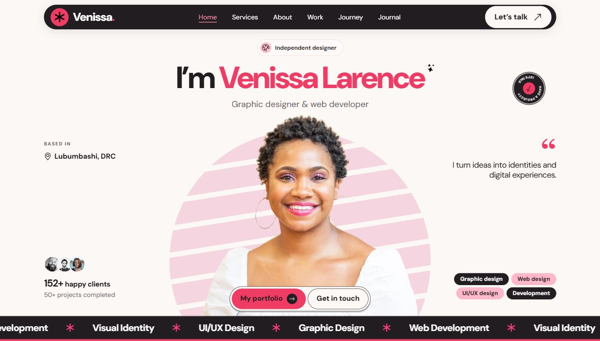

# Venissa portfolio

A static Astro portfolio built with React and Tailwind CSS for an independent designer. The home page introduces the designer, services, selected projects, process, journal and contact details. Every project and journal entry has its own shareable page.



## Quick start

Use Node.js 24 LTS and npm. From the repository root, run the following commands.

```sh
npm ci
npm run dev
```

Open the local address printed by Astro. To build and inspect the production site, run the following commands.

```sh
npm run check
npm run build
npm run preview
```

Deploy the contents of `dist/` to a static host at the root of a domain. The site needs no server-side runtime, account or API key. Email and telephone links open the visitor’s configured applications.

Astro owns routing, Markdown collections and static generation. The interface lives in React components in `src/components/`. Only the header and project filters hydrate in the browser. Tailwind CSS is compiled through its Vite plugin. Shared theme colors and component styles live in `src/styles/portfolio.css`.

## Make it yours

| Content                                                           | Location                     |
| ----------------------------------------------------------------- | ---------------------------- |
| Name, biography, portraits, contact details and portfolio metrics | `src/data/profile.json`      |
| Service descriptions and tags                                     | `src/data/services.json`     |
| Dated journey milestones                                          | `src/data/journey.json`      |
| Project process                                                   | `src/data/process.json`      |
| Client testimonials                                               | `src/data/testimonials.json` |
| Project pages                                                     | `src/content/projects/*.md`  |
| Journal articles                                                  | `src/content/journal/*.md`   |
| Colors, typography, responsive layouts and motion                 | `src/styles/portfolio.css`   |

Copy an existing Markdown entry and give it a descriptive English filename such as `studio-identity.md`. The filename determines its URL. The front matter supplies the title, summary, category and display order. Projects also require an image path and alternative text. Add the page body below the front matter. Collection schemas in `src/content.config.ts` check required fields at build time. The project filters are generated from the categories in your files.

To publish a testimonial, add an object with `name`, `role` and `quote` to the JSON array. An empty array hides the entire section. Use approved quotations and replace the demo identity, contact details, project metrics and imagery before using the template for another person.

The project gallery and article pages work without JavaScript. JavaScript adds project filters, active navigation and the compact mobile menu. Motion follows the visitor’s reduced-motion preference.

## Contributing

For local setup, validation commands, commit conventions and pull requests, see the [contribution guide](CONTRIBUTING.md).

## License and assets

The template code is available under the [MIT License](LICENSE). DM Sans and Bootstrap Icons retain their own license notices. The supplied demo portraits, client photographs and project screenshots have separate reuse conditions. See [asset notices](ASSETS.md).

Each project can set an optional HTTP or HTTPS `previewUrl` in its Markdown front matter. The six demo links point to `https://balick.me/`. Replace them with your project URLs when personalizing the template.
